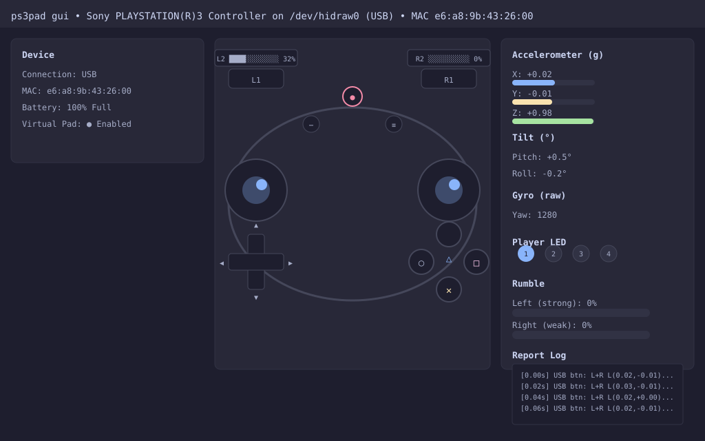

# PS3Pad

Self-contained Sony DualShock 3 / SIXAXIS driver and tester for Linux, Windows, and macOS.

## Features

- **Protocol support** (`ps3pad-core`): Full decode of USB/Bluetooth input reports (buttons, sticks, pressure, battery, accelerometer, gyro), LED/rumble output reports, pairing, and the official HID report descriptor.
- **Hybrid architecture** (`ps3pad-platform`):
  - Linux: Direct `/dev/hidraw*` access + virtual gamepad via `/dev/uhid` (no hidapi, no libudev).
  - Windows: Native SetupAPI/HidD/overlapped I/O for physical controllers; KMDF/VHF kernel driver for virtual gamepad.
  - macOS: IOKit/IOHIDManager FFI for physical controllers; `IOHIDUserDevice` (user-space, DriverKit-free) for virtual gamepad.
- **Applications** (`ps3pad`):
  - CLI: `list`, `dump`, `doctor`, `led`, `pair`, `uhid-test`.
  - Daemon: Bridges physical controller → virtual gamepad with Unix-socket JSON control.
  - GUI: Native egui tester with live visualization of buttons, sticks, pressure, battery, motion, and rumble/LED controls.

## Requirements

- **Linux**: Kernel ≥ 5.10 (`hidraw`, `uhid` modules), udev rules for non-root access (provided).
- **Windows**: Windows 10+ (VHF requires kernel-mode driver; user-mode VHF is not supported). Test-signing or attestation signing required for driver installation.
- **macOS**: macOS 12+ (Monterey), Xcode command-line tools. `IOHIDUserDevice` runs in-process on a CFRunLoop thread; no DriverKit entitlements needed.
- **Rust**: 1.85+ (MSRV tracked in workspace).

## Building

```bash
# Linux (default target)
cargo build --workspace --release

# Cross-check Windows / macOS from Linux
cargo check --target x86_64-pc-windows-msvc --workspace
cargo check --target x86_64-apple-darwin --workspace
cargo check --target aarch64-apple-darwin --workspace
```

### Windows driver (KMDF/VHF)

Located in `drivers/windows/`:

1. Open `drivers/windows/ps3padvhf.vcxproj` in Visual Studio 2022 with WDK.
2. Build the driver (`x64` / `Release`).
3. Install with `devcon` or `pnputil` (requires test-signing or attestation):
   ```cmd
   devcon install ps3padvhf.inf "Root\Ps3padVhf"
   ```
4. The driver creates `\DosDevices\Ps3padVhf` for the Rust virtual-pad backend.

See `drivers/windows/BUILD.md` for detailed instructions.

### macOS

No special build steps. The Rust code links against IOKit and CoreFoundation system frameworks. Run the binary directly; the virtual HID device appears on a background CFRunLoop thread.

## Installation (Linux)

```bash
sudo install -m 0644 drivers/linux/60-ps3pad.rules /etc/udev/rules.d/
sudo udevadm control --reload-rules
sudo udevadm trigger
```

After this, `ps3pad list` / `dump` / `gui` work without `sudo`.

## Usage

```bash
# List detected controllers
ps3pad list

# Dump live reports (decoded)
ps3pad dump

# Raw hex dump
ps3pad dump --raw

# Set player LED (1-4, 0 = off)
ps3pad led 2

# Store host Bluetooth MAC for pairing (USB only)
ps3pad pair aa:bb:cc:dd:ee:ff

# Test virtual gamepad without a controller
ps3pad uhid-test --seconds 10

# Bridge physical → virtual gamepad (daemon)
ps3pad daemon --socket /tmp/ps3pad.sock

# Control daemon via Unix socket
echo '{"type":"status"}' | socat - UNIX-CONNECT:/tmp/ps3pad.sock

# Graphical tester
ps3pad gui
```

## GUI Screenshot



*The graphical tester (`ps3pad gui`) shows live controller state: button grid, analog stick positions, pressure bars for all 12 analog buttons, battery level with charging state, accelerometer/tilt/gyro readouts, LED player indicators, rumble sliders, virtual-pad toggle, and a scrolling report log.*

## Architecture

See `docs/ARCHITECTURE.md` for the crate layout, transport abstractions, and virtual-HID event flow.

## Protocol

See `docs/PROTOCOL.md` for the DualShock 3 report layout, byte offsets, and output report format.

## Reverse Engineering

See `docs/REVERSE_ENGINEERING.md` for sources, provenance, and methodology.

## License

MIT OR Apache-2.0